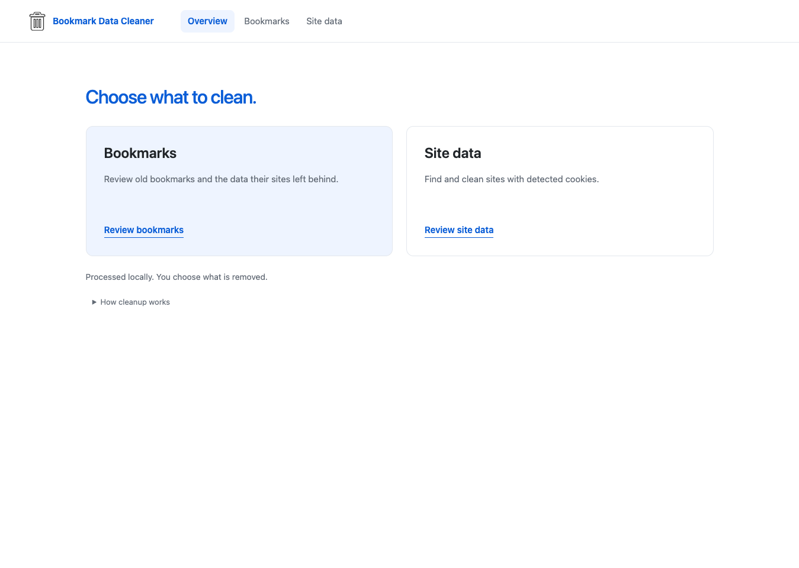
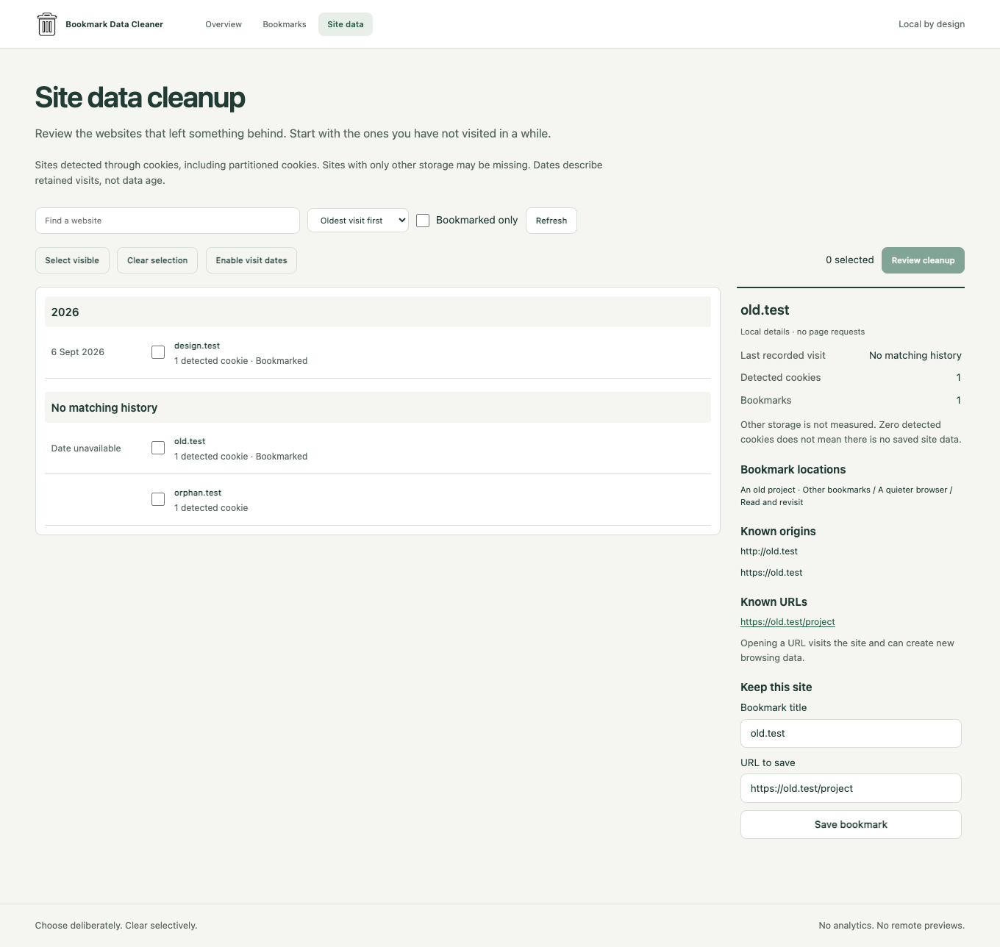

# Bookmark Data Cleaner

**Choose the sites. Clear their data.** A local Chrome extension for selective cleanup, starting from bookmarks or detected site cookies.

- **Overview:** choose bookmark cleanup or site data cleanup.
- **Bookmarks:** collapsible folders, bulk selection and local metadata.
- **Site data:** detected-cookie inventory, last-visit timeline, search and bookmark filter.
- **Cleanup:** review cookies, saved site data, caches, workers and optional bookmark removal before confirming.

Site discovery uses cookies, including partitioned cookies; storage-only sites may be missing. History enriches the list when permitted. It is not the inventory source. No remote previews, favicons, analytics or runtime dependencies.

## Run

Node 24+; Chrome 130+ API baseline.

```sh
npm ci
npm run build
```

In `chrome://extensions`, enable Developer mode and load **`dist/extension/`**. Click the toolbar icon to open the app. After source changes, rebuild and reload the extension.

## Develop

```sh
npm run typecheck
npm test
npm run build
```

Source lives in `extension/`: TypeScript, native HTML and custom CSS. Development dependencies are TypeScript and Chrome/Node typings. All shipped assets are local.

- [Running and browser tests](docs/development.md)
- [Rebranding plan and implementation status](docs/rebranding-plan.md)
- [Architecture and limits](docs/architecture.md)
- [Stage 1 release notes](docs/release-notes.md)

The public name and icon are retained for this development branch. The toolbar quick-clean popup is Stage 2. This branch has not been published to the Chrome Web Store.

## Screenshots



