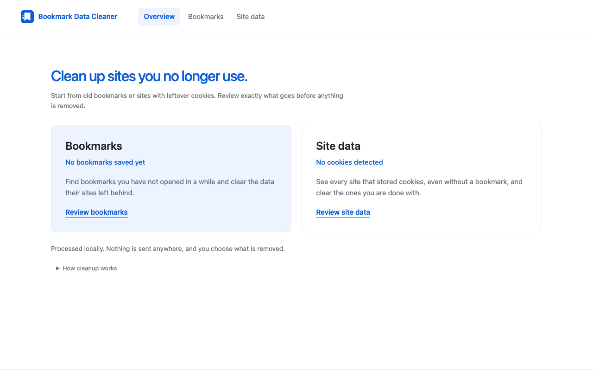
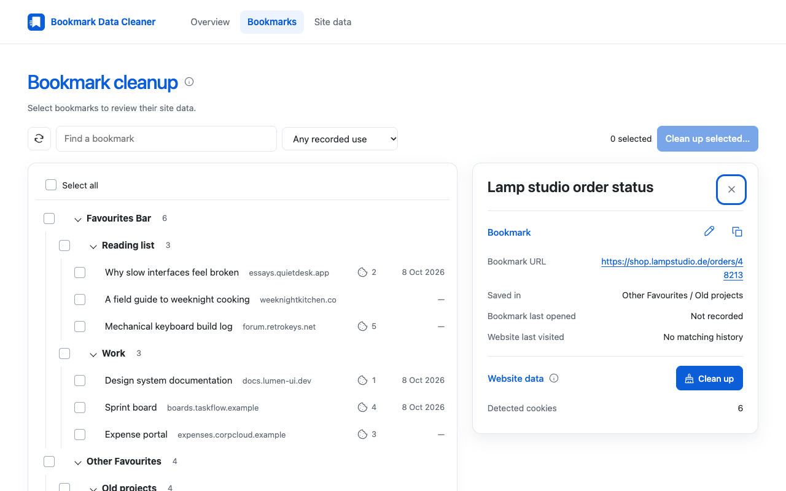
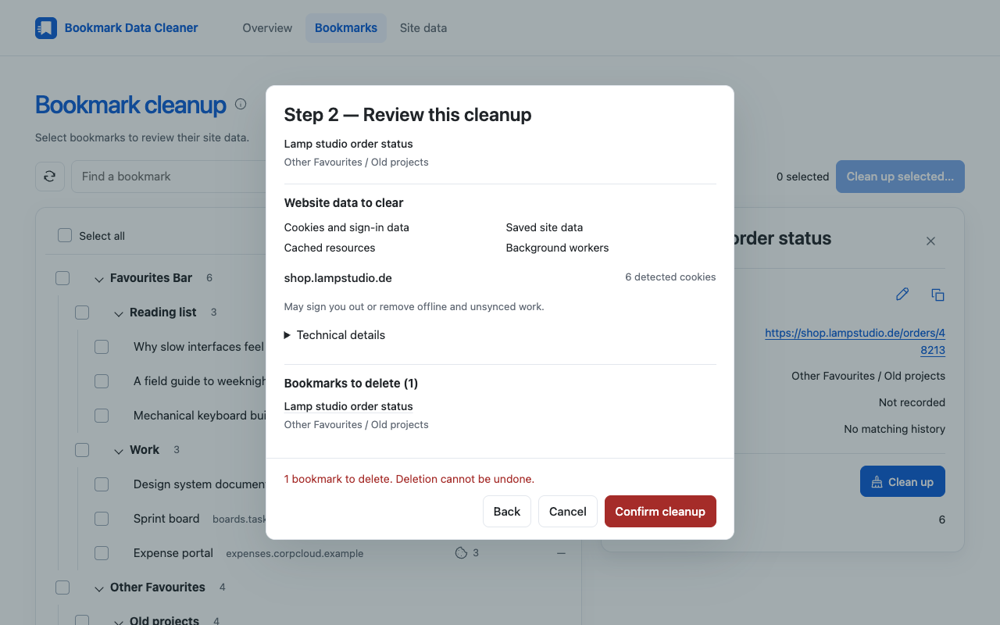

# Bookmark Data Cleaner

**Choose the sites. Clear their data.** A local Chrome/Edge extension for selective cleanup, starting from bookmarks or stored cookies, with a full review before anything is deleted.

- **Overview:** live bookmark and cookie-site counts; pick where to start.
- **Bookmarks:** collapsible folders, search, and a filter for bookmarks unused for 6 months to 2 years or with no recorded use. Each row shows its domain, detected cookies and last use.
- **Site data:** every site that stored cookies, bookmarked or not, with last-visit ordering and filters.
- **Cleanup:** choose data types, then review the exact sites, cookie scope and affected bookmarks before confirming. Results say what completed, failed or was kept.

Site discovery uses cookies, including partitioned cookies; storage-only sites may be missing. History is optional and only adds visit dates. No network requests, analytics or runtime dependencies. See the [privacy policy](docs/privacy.md).





## Run

Node 24+; Chrome 130+ API baseline. Edge is also supported.

```sh
npm ci
npm run build
```

In `chrome://extensions` (or `edge://extensions`), enable Developer mode and load **`dist/extension/`**. Click the toolbar icon to open the app. After source changes, rebuild and reload the extension.

## Develop

```sh
npm run typecheck
npm test
npm run build
CHROME_BIN='/path/to/Chrome for Testing or Edge' npm run test:browser
```

Source lives in `extension/`: TypeScript, native HTML and custom CSS. Development dependencies are TypeScript and Chrome/Node typings. All shipped assets are local.

- [Running, browser tests and release checks](docs/development.md)
- [Architecture and limits](docs/architecture.md)
- [Store listing, permission justifications and assets](docs/store-listing.md)
- [Release notes](docs/release-notes.md)
- [Evaluations and refinement history](docs/improvements/README.md)

## Release

Fill the privacy and issue-tracker URLs in `extension/links.ts`, run the checks above, then zip the contents of `dist/extension/` with `manifest.json` at the archive root. [docs/store-listing.md](docs/store-listing.md) has the full checklist and listing text.
